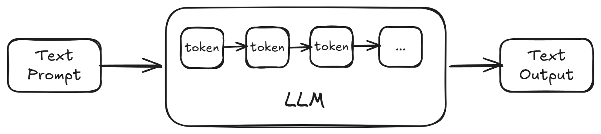
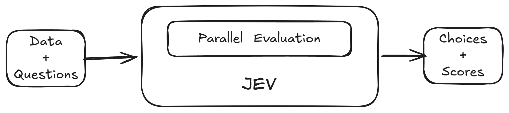
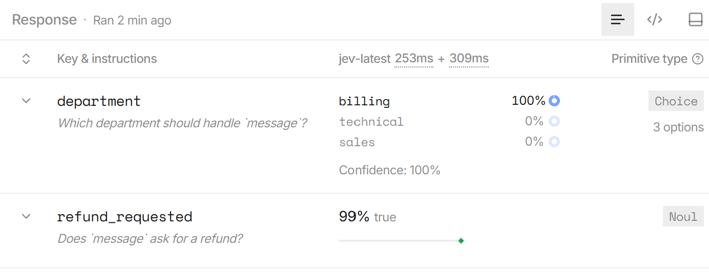

## What is Jev?

In this age of AI, it seems like a new model with improved benchmarks is released every other day while companies race to outdo each other and reach AGI first. One day an Anthropic model is state of the art and another day it's an OpenAI model, but many recent models follow the same blueprint: an LLM with reasoning capabilities. We input text (a prompt) and the model outputs text.

TypeSafe AI (the company behind Jev) is taking a different approach and solving a different problem altogether compared to other major AI labs.

## Why

A big problem with LLMs is their open-endedness. They can answer a prompt one way and give a totally different answer another time. Their responses can also be vague, making it hard to reach a concrete conclusion. So when we need to make a clear-cut decision, LLMs are not always the best tools to use. Their latency adds to that equation too. Reasoning models can take a minute or more to answer even simple prompts at their highest thinking level. So if you need to quickly choose between multiple options, a reasoning model may be more than you need.

For LLMs like Claude or GPT, we usually provide a text prompt and get a text answer. For Jev, we provide some data and a list of typed questions, and it responds with structured answers and probabilities. By design, it's not intended to be used as a typical LLM for daily tasks like answering general questions or code completion. It's intended as a tool for quick classification or decision-making inside our existing workflows, whether that's a coding agent or a regular application.





## Traditional LLMs vs Jev

| Traditional LLMs | Jev |
| --- | --- |
| Can generate open-ended text or structured output | Produces predefined structured values |
| Generate tokens sequentially | Computes outputs in parallel |
| Confidence can be unreliable | Returns calibrated probabilities |
| Designed primarily for human interaction | Designed for software automation |

### Practical Example

Let’s take an example: a customer tells a chatbot that their credit card was charged twice for the same payment. As the developer, we need to decide which department to route the request to. If we are using a typical LLM, we would gather the customer's non-PII data, their question and any additional context, and send that to our chosen LLM. Depending on the model and reasoning settings, this can take a minute or more. A free-form response can be hard to interpret using code, though LLMs can also return structured JSON like the example below.

#### Sample LLM response

```json
{
  "department": "billing",
  "urgent": true
}
```

Using Jev, we can just provide the customer message, a set of questions and possible answers.

#### Sample Input to Jev

```
Question 1 — Choice:
Which department should handle this?
Options: billing, technical, sales, other

Question 2 — Noul:
Does this message require urgent attention?
```

Jev can return a response in under a second. Here's a simplified example with illustrative probabilities:

```json
{
  "department": {
    "choice": "billing",
    "probabilities": {
      "billing": 0.97,
      "technical": 0.01,
      "sales": 0.00,
      "other": 0.02
    },
    "confidence": 0.94
  },
  "urgent": {
    "noul": 0.88
  }
}
```

As you can see, this is easy to handle in existing code, say inside a switch or if statement. The probabilities also let us decide when to act on the answer or send it for review.

## Trying the Example in ChatGPT and Jev

I tried the above example using ChatGPT 5.6 Sol and Jev to get a clearer idea of the two approaches.

### GPT 5.6 Sol - Medium

#### Prompt

```
Analyze the following customer message:

"I was charged twice for my subscription. Please refund the extra charge."

Answer these questions:

1. Which department should handle the message?
   Choose exactly one: billing, technical, or sales.

2. Does the message ask for a refund?
   Answer true or false.

Return only valid JSON in this format:

{
  "department": "billing | technical | sales",
  "refund_requested": true
}
```

#### Response

```json
{
  "department": "billing",
  "refund_requested": true
}
```

#### Time Taken

~30 seconds

### Jev Latest

#### State

```json
{
  "message": "I was charged twice for my subscription. Please refund the extra charge."
}
```

#### Questions

```json
{
  "department": {
    "type": "choice",
    "instructions": "Which department should handle `message`?",
    "criteria": {
      "billing": "Payments, charges, subscriptions, or refunds",
      "technical": "Bugs or product problems",
      "sales": "Pricing or purchasing questions"
    }
  },
  "refund_requested": {
    "type": "noul",
    "instructions": "Does `message` ask for a refund?"
  }
}
```

#### Response

```json
{
  "model": "jev-1.13.0",
  "answers": {
    "department": {
      "type": "choice",
      "choice": "billing",
      "confidence": 1,
      "probabilities": {
        "billing": 1,
        "technical": 0,
        "sales": 0
      },
      "stats": {}
    },
    "refund_requested": {
      "type": "noul",
      "noul": 0.99,
      "stats": {}
    }
  },
  "usage": {
    "input_tokens": 371,
    "output_tokens": 56
  },
  "request_id": "playground_1c9de7dd571f94242fca5a86f03265bb90c",
  "evaluation_time_ms": 253.46450500001083
}
```

#### Response Time

~250 ms

## 30 s vs 250 ms!

In this test, Jev answered both questions correctly in about 250 milliseconds, while GPT 5.6 Sol took about 30 seconds. This is just one example, and the timing will depend on the model, settings and request.

The TypeSafe AI playground has a nice visualization of the questions, choices and answers, as seen below.



## What Jev is Not

Jev isn't a chatbot or a coding assistant. It won't write a reply to the customer, generate code or explain its reasoning. It's also not built for problems that need several steps of reasoning. In our example, Jev can decide which department should handle the message, but writing a response would still be a job for an LLM or a person.

## Conclusion

In this article, I explored what Jev is, how it differs from a traditional LLM and where it could fit into an existing application. I also tried a simple example to compare the two approaches. In future articles, I hope to dive deeper into Jev and try it out in more practical use cases.

If you want to dive deeper, check out [Flavio Copes' article on Jev](https://flaviocopes.com/jev/) and the [TypeSafe AI documentation](https://docs.typesafe.ai/introduction).
