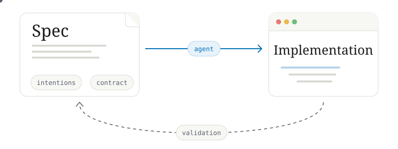
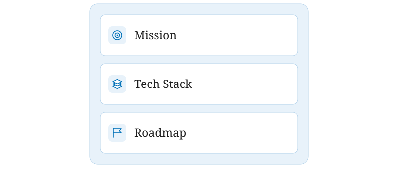

Developers all around the world have followed SDLC, the software development life cycle, for multiple decades to develop and deliver software. SDLC guided developers and teams on how to plan, develop, test and deploy software successfully.

And then AI happened. 

People started generating code instead of writing code manually. It started as simple suggestions in Cursor/Copilot and evolved into full-fledged code generation (vibe coding) in a few years. As of now, some software engineers cannot even remember a time when they wrote a single function by hand.

With all this vibe coding and code generation come a lot of issues. This happens in large codebases when vibe coding or excessive code generation gets out of hand.

## Major Issues with Unsupervised Agentic Code Generation

### Code Fragmentation

When you have a complex application with a large codebase and are implementing small features, the generated code of the feature might not align with the overall architecture and design of the project, making the code inconsistent across various places in the codebase.

### Loss of Intent and Planning

When people are just raw-prompting codebases and generating features using AI, and multiple people are doing the same thing, code can get jumbled and the intent of the code could get lost between sessions. After several months, the code could become totally unmanageable due to lack of context and intent.

### Context Drift

This also happens when code is generated without a broader understanding of the system. With longer agentic sessions, the problem which the AI thinks it’s working on and the original intention could drift apart, paving the way to a plethora of issues in the short and long term.

# Specification-Driven Development - SDD

To address the above-mentioned issues, a new paradigm, a worthy (?) successor, is here: SDD, which is built on decoupling the specification from the implementation.



Spec-driven development mainly focuses on a human-in-the-loop approach with a detailed requirement document called a ‘spec’. Specs are intended to be persisted between sessions. Detailed specifications of implementation details are created and verified before providing them to agent/s to implement. The specs are mainly written in natural language.

This approach treats agents/LLMs as pair programmers whom we guide via structured documentation.

DeepLearning.AI provided a great analogy for this with architects and builders: architects write blueprints for buildings, specifying what to build, how to build it, etc., and builders ingest that blueprint and build the real-world building, strictly following the blueprint.

# Spec

If we deep dive into the spec, there are two levels of specs: the project-level spec, which some call the “constitution”, and feature-level specs.

### Constitution, the Project-Level Spec

As the name suggests, this lives in the root of the project and specifies the overall objective, the mission, targeted tech stack and overall roadmap. The constitution also consists of high-level principles, which child specs and implementations should always follow.



- Mission - Core idea
- Tech Stack - Targeted tech stack
- Roadmap - What features are planned

```Markdown
# Project Constitution — TaskFlow

## Mission
TaskFlow is a lightweight task manager for small remote teams who find Jira/Asana
too heavyweight. Core value: a team can go from "we need to track this" to a
tracked, assigned task in under 10 seconds.

## Tech Stack
- Frontend: React + TypeScript, Tailwind CSS
- Backend: Golang, PostgreSQL
- Auth: Clerk
- Hosting: Vercel (frontend), VPS/Supabase (backend + DB)
- No GraphQL — REST only, keep the API surface small

## Principles
- Every feature must work without a mouse (keyboard-first)
- No feature ships without a corresponding feature-spec in /specs
- Prefer boring, well-documented libraries over novel ones
- Mobile is read-only for v1 — no mobile write flows yet

## Roadmap
1. Task CRUD + assignment (MVP)
2. Team workspaces
3. Slack integration for notifications
4. Recurring tasks
5. Reporting dashboard

## Out of Scope (for now)
- Time tracking
- Billing/invoicing
- Native mobile apps
```

### Feature-Level Specs

These specs sit one layer below the constitution and define individual features or changes. A feature-level spec should dive deeper into the feature, its boundaries and behavior, and should consist of goals, functional requirements, edge cases and acceptance criteria.

```Markdown
# Feature Spec — Task Assignment

## Goal
Allow a team member to assign a task to exactly one other team member.

## User Story
As a team member, I want to assign a task to a teammate so they know it's
their responsibility.

## Requirements
- A task has at most one assignee at a time
- Only workspace members can be assigned
- Assigning a task notifies the assignee (in-app, not email for v1)
- Reassignment overwrites the previous assignee (no history kept in v1)
- Unassigned tasks show as "Unassigned" in the task list

## Edge Cases
- Assigning to a user who was removed from the workspace → reject with error
- Assigning a task that's already completed → allowed, no notification sent

## Acceptance Criteria
- [ ] API endpoint `PATCH /tasks/:id/assign` exists and validates assignee membership
- [ ] UI shows assignee avatar on task card
- [ ] Notification appears in assignee's inbox within 1s of assignment
```

After several iterations, the spec hierarchy of a project would look something like this.



# Conclusion

Spec-driven development does not reject AI-generated code; it regularizes it and puts a blueprint underneath. It transforms aimless vibe coding into contract-driven development, where the human writes the contract and validates it, leading to more structured and regulated codebases.

As with all AI-related technologies and hype, this is also a developing topic and may evolve into something else in a few years' time; that's the speed things are developing right now. But SDD lays a solid foundation for codebases and for regulating AI-generated code in a manageable way.
